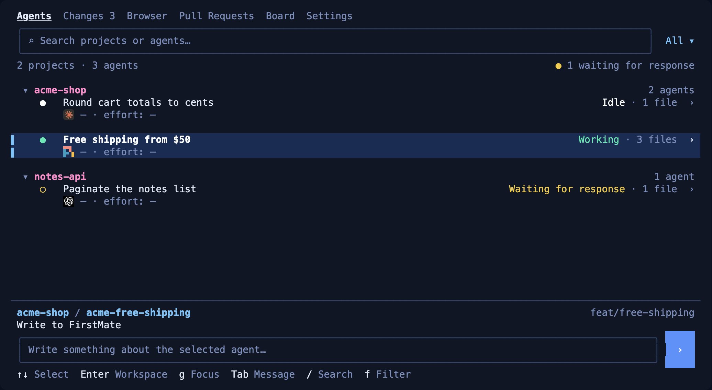
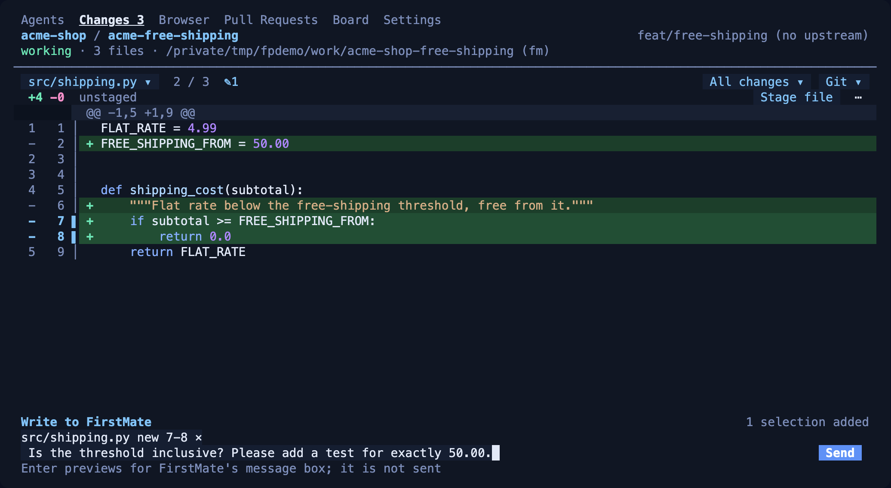
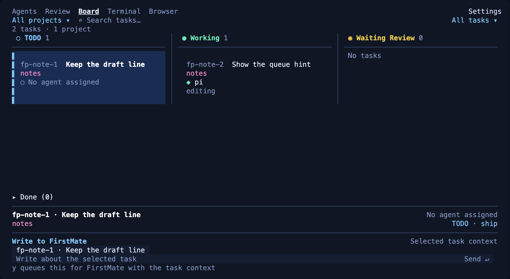

# Firstpane

Firstpane is a [Herdr](https://herdr.dev) plugin that opens a terminal pane for watching the coding agents in your Herdr session. It groups the agents by project and shows each agent's changed files with numbered diffs, its pull request, a browser of its own, and, with [FirstMate](#firstmate-optional), a read-only task board. It is a regular split pane, not part of Herdr's native Agents or Spaces sidebar.

Version **0.1.0** (`herdr-plugin.toml`). Source: [inkayat/firstpane](https://github.com/inkayat/firstpane); `v0.1.0` identifies the clean initial source snapshot, not a cross-platform installation test or a hosted release with binary assets. The original private development history is not part of this source distribution.

**Agents**: agents grouped by project, with status, changed files and harness.



**Changes**: a numbered diff. Lines 7–8 are selected and attached to an unsent note to FirstMate.



**Board**: FirstMate's tasks in TODO, Working, Waiting Review and Blocked lanes, read-only.



<sub>These are real Firstpane 0.1.0 screens, drawn from demo data in an isolated Herdr session. The projects, tasks and agents are made up: each agent's status was reported to Herdr by hand, no model was running, and the board tasks were added by hand with `fm-board`. Model and effort show as `—` because none were recorded. Herdr's colored text snapshot of the pane was rendered to PNG, with the bundled harness icons drawn where a terminal shows them through kitty graphics. The message in the Changes screen is an unsent draft.</sub>

## Features

- **Agents**: the agents Herdr detects in your session, grouped by project. Each row shows the title, status, changed-file count, harness icon, and the model and effort FirstMate recorded at launch. Search with `/` and filter by status with `f`. `g` focuses the agent's Herdr pane.
- **Changes**: the selected agent's worktree, one file at a time, with old and new line numbers. Stage and unstage files. A Git menu offers commit, fetch, fast-forward pull and push. Select diff lines to write a note to FirstMate about them.
- **Pull Requests**: the PR for the selected agent's branch, or any open PR in your projects. It has Files, Comments and Checks views. You can post a GitHub comment and resolve review conversations. It uses your logged-in `gh` CLI.
- **Board** (FirstMate only): a read-only view of FirstMate's task board, with TODO, Working, Waiting Review, Blocked and Done lanes. You cannot add, move or close tasks here.
- **Browser**: the selected agent's own `terminal-browser`, either drawn inside Firstpane's Browser tab or opened in a new Ghostty tab (macOS). Each agent gets its own browser profile. Use the browser's select tool to write a note to FirstMate about part of a page.
- **Settings**: where the browser opens (Ghostty tab or Inside Firstpane), and which tabs are shown. The choices are saved and kept across restarts.

Every write needs a preview and `y`: Git operations, GitHub comments, resolving a conversation, and FirstMate messages. A click never performs one. Drafts are kept per agent.

## Requirements

| | Required | What was actually checked |
| --- | --- | --- |
| OS / CPU | macOS or Linux, arm64 or x86_64. No Windows support. | The demo renders above were produced on macOS arm64 with Herdr 0.9.5. The existing CI workflow runs unit tests on Ubuntu with Python 3.11. |
| Herdr | 0.9.0 or newer | Checked by the installer and by Herdr's plugin manifest. |
| Python | 3.11 or newer. Standard library only. | Checked by the installer. |
| Git | yes (no minimum version is checked) | Required by the installer and the Changes tab. |
| `gh` CLI | logged in to each GitHub host you use | Only the Pull Requests tab needs it. |
| Ghostty 1.3+ | only for the Ghostty-tab browser on macOS | — |

The unit tests run on Ubuntu in CI. The installer and a live Firstpane pane have not been verified on Linux or Omarchy; Linux support rests on the code and the pinned Linux browser builds.

## Install

> [!IMPORTANT]
> This command is the public source entrypoint. Anonymous source access and synthetic/offline checks are not a live installation test: this publication has not exercised actual installer activation, download or upgrade on macOS or Linux. Review the plan with `--check` before accepting installation.

```sh
git clone --depth 1 https://github.com/inkayat/firstpane.git -- "$HOME/.local/share/firstpane-bootstrap" && python3 -- "$HOME/.local/share/firstpane-bootstrap/bin/install-firstpane"
```

The Add context patch is bundled in `docs/`, with its existing SHA-256 and size pins; no private historical commit or anonymous raw-helper download is needed. Offline synthetic patch/copy checks are not proof of a live installation.

The installer pins that exact public origin and is designed for macOS and Linux (arm64 or x86_64). Git, Python 3.11+ and Herdr 0.9.0+ must already be installed. It does not install them, use sudo, or edit shell startup files. Its intended flow from a published clean checkout is:

1. prints its plan and asks before changing anything (`--check` prints the plan only; `--yes` accepts it without asking);
2. clones the clean checkout to `~/.local/share/firstpane/src` (`$XDG_DATA_HOME/firstpane/src` if that is set), then links and enables it as the `firstpane` Herdr plugin;
3. downloads the pinned terminal-browser 0.13.4 for your platform, checks its SHA-256, and applies the checksum-verified bundled select-tool patch (skipped when a valid patched copy is already installed or configured);
4. writes `terminal_browser_root`, and the FirstMate paths if any, to the plugin's `config.json`. Keys you already set are kept.

FirstMate is optional. The installer uses FirstMate's paths if it can find them, and asks otherwise. Pass `--firstmate-home` and `--firstmate-root` to choose them, or `--without-firstmate` to skip FirstMate. On Linux, if the browser's shared libraries are missing, the installer names the Debian packages to install (`libnss3 libgtk-3-0 libasound2t64 libgbm1`) and exits with code 4. The files it installed stay in place.

The installer does not open a pane. To open one:

```sh
herdr plugin pane open --plugin firstpane --entrypoint tree
```

To upgrade, run `git -C ~/.local/share/firstpane-bootstrap pull --ff-only`, then run the installer again. The previous source moves to `~/.local/share/firstpane/src.previous`. The installer will not replace an existing `src.previous`, so move it aside before the next upgrade.

<details>
<summary>Manual install from a checkout</summary>

Use a checkout that will stay where it is. Linking is user-global, so do not link a disposable worktree.

```sh
herdr plugin link /path/to/firstpane
herdr plugin enable firstpane
herdr plugin pane open --plugin firstpane --entrypoint tree
```

The manual steps do not download terminal-browser or apply its select-tool patch. To use the Browser tab, set `terminal_browser_root` yourself (see [Configuration](#configuration)). Without the patch in `docs/terminal-browser-0.13.4-context.md`, a note typed into the select tool's tooltip cannot be previewed without opening a second editor.

</details>

## Use

The pane opens where you run the open command. To toggle it with a key, bind the plugin's `firstpane.toggle` action in your Herdr config. Firstpane does not set up a key binding.

```toml
[[keys.command]]
key = "ctrl+alt+p"
type = "plugin_action"
command = "firstpane.toggle"
description = "Toggle Firstpane beside the focused pane"
```

The toggle opens Firstpane beside the focused pane without moving focus. It closes only a Firstpane it opened itself. Closing Firstpane ends its process. Drafts and UI state are saved under `HERDR_PLUGIN_STATE_DIR`.

| Key | Action |
| --- | --- |
| `1`–`6` | The tabs shown in the tab row, numbered from 1 in their usual order (Agents, Changes, Browser, Pull Requests, Board, Settings). Hide tabs and the numbers close up: with only Agents and Settings shown, `1` is Agents and `2` is Settings. If Settings is hidden, `6` still opens it |
| `j` / `k` or arrows | Move through lists and diffs |
| `Enter` | Select, open, or preview a message |
| `m` | Write to FirstMate about the selected agent, lines, page or task |
| `y` | Confirm the previewed write |
| `Esc` | Cancel or go back; drafts are kept |
| `r` | Refresh |
| `Ctrl-C` | Quit Firstpane |

Tab details:

- **Agents**: `Enter` makes the agent under the cursor the selected agent, which the other tabs act on. `g` focuses its Herdr pane. Rows show model and effort only for agents FirstMate launched; otherwise they show `—`. Harness icons for pi, omp, Claude, Grok and Codex need a terminal that shows kitty graphics through Herdr. Without it, or with `NO_COLOR`, the harness is named in text. Icon sources are listed in `firstpane/icons/SOURCES.md`.
- **Changes**: `Tab` opens the file list and `[` / `]` move to the previous or next file. `w` picks the scope: all changes, workspace or staged. `s` / `u` stage or unstage the file. `g` opens the Git menu: commit staged (the message is written in your editor), fetch, pull (fast-forward only) and push (never forced). Select lines with a click, `Shift`+arrows or `v`, then press `Enter` to attach them to a FirstMate message.
- **Pull Requests**: `p` lists open PRs. `Tab` switches between Files, Comments and Checks. `.` opens actions: open on GitHub, description, full diff, comment on GitHub, note to FirstMate. On a review conversation, `m` writes to FirstMate about it and `R` resolves it on GitHub. If a refresh fails, the last data stays on screen and says how old it is.
- **Board**: `←` / `→` change lane, `↑` / `↓` change task, `Enter` shows details, `g` focuses the task's agent, `p` / `/` / `f` filter by project, search, and active tasks. A narrow pane shows one lane at a time.
- **Browser**: opening the tab opens the selected agent's browser, or keeps it if it is already open. Only one agent's browser is open at a time. `x` closes it. `a` or `Ctrl-G` writes to FirstMate about the selected text on the page. The browser's select tool writes about the element you click. Inside Firstpane, the page fills the tab: `f`, `Enter` or a click on the page gives it the keyboard, and `Ctrl-O` gives it back to Firstpane. In a Ghostty tab, `f` or `Enter` brings that tab forward.
- **Settings**: choose Ghostty tab or Inside Firstpane with `j` / `k` and `Enter`. An open browser moves the next time the Browser tab opens it. A Beside Firstpane choice saved by an earlier version becomes Inside Firstpane. A browser pane that version opened beside Firstpane is neither reused nor closed; close it in Herdr. Below that, every tab has a `[x]` / `[ ]` row; `Enter`, `Space` or a click shows or hides it. A hidden tab leaves the tab row and the tab numbers are counted again from 1 over the tabs left, in the tab row and on the number keys; its data, drafts and any browser it opened are kept, and showing it again brings it back as it was. Everything is shown until you hide it. Settings can be hidden too, but `6` then still opens it, so the other tabs can always be shown again. If every tab is hidden the tab row is empty and `6` is the way in. If the saved tab is hidden, Firstpane starts on the first shown tab, or on Settings when none is shown.

### FirstMate (optional)

Without FirstMate, Firstpane lists Herdr-detected agents, shows changes, works with Git and pull requests, and opens browsers. With FirstMate configured, you also get the Board, model and effort on Agents rows, and messages:

- **Messages are not sent by Firstpane.** On the preview, `y` pastes the message unsent into FirstMate's own message box, and you press `Enter` there. This applies to messages from Agents, Changes lines, Browser picks, PR conversations and Board tasks. It works only with a **pi** FirstMate that is idle, scrolled to the bottom, with an empty editor. Firstpane checks this at the preview and again at `y`, and never touches text already in the box. The status line says whether the message arrived: `in FirstMate's message box`, `not transferred: <reason>`, or `transfer unconfirmed`.
- **PR notes** (`.` → Note to FirstMate) are different: they are queued through FirstMate's `fm-inbox.sh`, and `a` announces saved notes.

## Configuration

Run `herdr plugin config-dir firstpane` to find the configuration directory. Settings go in `config.json` there. The installer writes this file. Paths you leave out are not guessed.

```json
{
  "firstmate_home": "/path/to/firstmate-home",
  "firstmate_root": "/path/to/firstmate-tool",
  "project_root": "/path/to/projects",
  "editor": ["vi"],
  "github_hosts": ["github.com"],
  "remotes": {"/absolute/project/path": "upstream"},
  "terminal_browser_root": "/path/to/terminal-browser-0.13.4"
}
```

| Key | Meaning |
| --- | --- |
| `firstmate_home` | FirstMate's operational home (`FM_HOME`). Messages need it. |
| `firstmate_root` | The FirstMate tool checkout containing `bin/fm-inbox.sh`. Must differ from `firstmate_home`. PR notes and the Board need both. |
| `project_root` | Directory whose direct Git checkouts form the project list. Defaults to `firstmate_home/projects` when FirstMate is configured. |
| `project_allowlist` | A list of project paths to use instead of `project_root`. |
| `editor` | Editor command as an argument list. Defaults to `$VISUAL`, then `$EDITOR`, then `vi`. |
| `github_hosts` | GitHub hosts to query. Defaults to `["github.com"]`. |
| `remotes` | Remote name per project path. Defaults to `origin`. |
| `terminal_browser_root` | The unpacked terminal-browser 0.13.4 directory containing `bin/terminal-browser`. `PATH` is not searched. |

Once FirstMate or a project scope is configured, agents outside that scope are hidden. With neither, every agent Herdr detects is listed, but there is no default PR inventory beyond the agents' own projects.

## Known limitations

- **Source distribution**: `v0.1.0` is the initial clean source tag, not a hosted release with binary assets. Actual installer activation/download/upgrade has not been exercised for this publication (see [Install](#install)). No project-wide license is present; third-party attribution and vendor mark conditions are retained in [`firstpane/icons/SOURCES.md`](firstpane/icons/SOURCES.md), not replaced by a new license or permission claim.
- **Linux**: the Ghostty-tab browser is macOS-only, but it is the default placement on every OS. On Linux, choose **Inside Firstpane** in Settings before using the Browser tab. The installer and the live pane have not been tested on Linux or Omarchy.
- **Browser**: Inside Firstpane can be slow, and that is not fixed. Page frames reach the pane as kitty graphics through Herdr; sent inline, they update about twice a second. The tab says so when the terminal accepts neither shared-memory nor file frames, but Herdr can also fall back to inline images for its client on its own, which Firstpane cannot see. Inside Firstpane the browser belongs to Firstpane and closes with it. Cookies and page state are lost when a browser closes; the profile and the last address are kept. A Ghostty tab opens only when Ghostty is the front app and has a window. Firstpane does not start or check development servers: agents using the same address reach the same server.
- **FirstMate messages**: only a pi FirstMate can receive them. A keystroke typed into FirstMate between Firstpane's last check and the paste can still land first. pi shows pastes longer than ten lines as `[paste #N +K lines]`.
- **Board**: read-only, and it depends on `fm-board` sitting next to the `fm` launcher on `PATH`. Cards do not show PRs or checks.
- **Agents**: model and effort are known only for agents launched by FirstMate. Icons need kitty graphics. The installer does not check for kitty graphics.
- **Pull Requests**: requires `gh` to be logged in already. Shows up to 20 open PRs per project.
- **Limits**: Git writes are never retried. A timeout is reported as an unknown outcome. Diffs are cut at 400 KB in Changes and 200 KB for PRs.
- **Installer**: no Windows support. It refuses a dirty checkout, a different `origin`, a foreign plugin link, and an existing `src.previous`.

## Development

```sh
python3 -m unittest discover -s tests -q
python3 -m py_compile firstpane/*.py
```

CI runs both on pull requests to `main`.

Board integration tests discover `fm-board` next to the symlink-resolved `fm` launcher on `PATH`, just like the application. They use synthetic FirstMate homes; if that external tool is unavailable, those tests explicitly skip. The classifier is not bundled with Firstpane.
