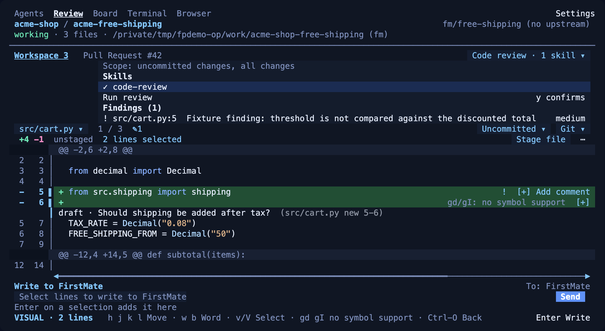
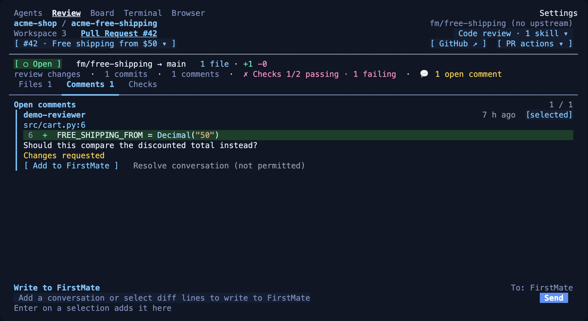
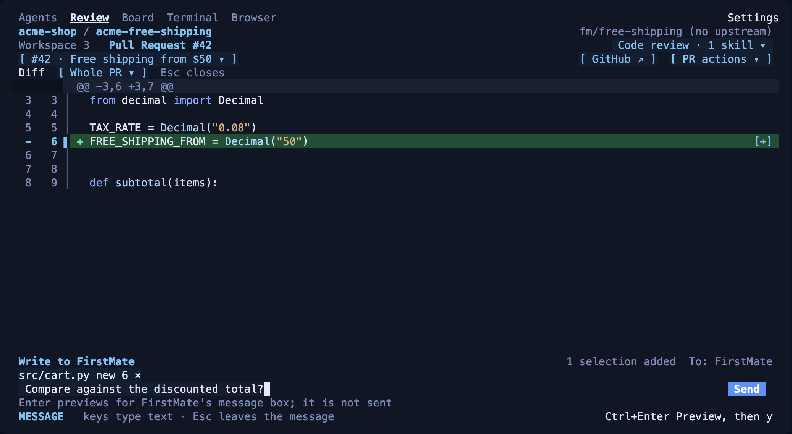
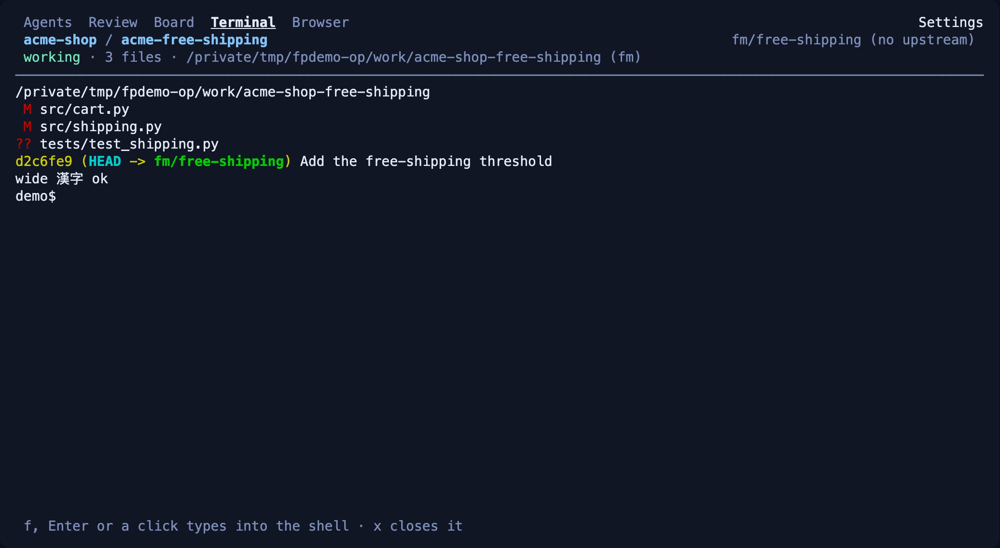

# Firstpane

Firstpane is a [Herdr](https://herdr.dev) plugin that opens a terminal pane for watching the coding agents in your Herdr session. It groups the agents by project and shows each agent's workspace changes and pull request in one Review tab with numbered diffs, a new shell in the agent's directory, a browser of its own, and, with [FirstMate](#firstmate-optional), a read-only task board. It is a regular split pane, not part of Herdr's native Agents or Spaces sidebar.

Version **0.1.0** (`herdr-plugin.toml`). Source: [inkayat/firstpane](https://github.com/inkayat/firstpane); `v0.1.0` identifies the clean initial source snapshot, not a cross-platform installation test or a hosted release with binary assets. The original private development history is not part of this source distribution.

**Agents**: agents grouped by project, with status, changed files and harness.


**Review**: the selected agent's workspace and its pull request in one tab, with `Workspace 3` and `Pull Request #42` sub-tabs, the `Code review` control, the file picker, the revision (`Uncommitted`) and Git menus. Every added line has a `[+]` to write about it, and the bar under the diff scrolls the long comment line sideways. Lines 5–6 are selected and attached to an unsent note to FirstMate. The `⤢` at the right of the sub-tab row is the focus control.

![Review tab, Workspace sub-tab: a numbered diff with lines 5–6 attached to an unsent note to FirstMate, per-line [+] marks and a horizontal scrollbar](docs/images/review.png)

The `Code review` menu: the scope it reviews, the skills to run with, `Run review`, and the findings of the last run, each opening its file and line. The cursor line says that `gd`/`gI` have no symbol support.



The `Pull Request` sub-tab: the PR's state, branches, commits, comments and checks, with Files, Comments and Checks views.



A pull request's diff opens in the same view, and its lines can be attached to a note to FirstMate.



**Terminal**: a new shell in the selected agent's directory, drawn in Firstpane's colors.



**Board**: FirstMate's tasks in TODO, Working, Waiting Review and Blocked lanes. The tab warning is qualified until a board read reports official inventory coverage.


<sub>These are real Firstpane 0.1.0 screens, drawn from demo data in an isolated Herdr 0.9.5 session. The projects, tasks, agents and pull request are made up: each agent's status was reported to Herdr by hand, no model was running, and the board tasks were added by hand with `fm-board`. Model and effort show as `—` because none were recorded. Pull request #42 comes from a stand-in `gh` that serves fixed data and never reaches GitHub, and the review finding comes from a stand-in review command, not a model. The Terminal shell is a plain `/bin/sh`. Herdr's colored text snapshot of the pane was rendered to PNG, with the bundled harness icons drawn where a terminal shows them through kitty graphics. The messages are unsent drafts. The Board warning and detail were checked separately against synthetic board data; those screens are not in these images.</sub>

## Features

- **Agents**: the agents Herdr detects in your session, grouped by project. Task clones that Git shows were made from the same project are listed under one heading. Each row shows the title, status, changed-file count, harness icon, and the model and effort FirstMate recorded at launch. Search with `/` and filter by status with `f`. `g` focuses the agent's Herdr pane. The tab shows `⚠ N` only for Waiting agents with a current user request. Enter on such an agent opens its linked Board task; there is no hover popup.
- **Review**: the selected agent's work in two sub-tabs. **Workspace** shows its worktree one file at a time, with old and new line numbers; the revision menu switches between the uncommitted changes (all, unstaged or staged) and the commits on the agent's branch. Stage and unstage files; a Git menu offers commit, fetch, fast-forward pull and push. **Pull Request** shows the pull request associated with the selected agent's branch or recorded task URL in that agent's repository, or a qualified absence or unknown: state, branches, commits, review state, comments and checks (with the failed-step log of a GitHub Actions check on request), and its diff, whole or one commit. Select diff lines in either sub-tab to write a note to FirstMate about them. You can post a GitHub comment and resolve review conversations (uses your logged-in `gh` CLI). If you configure a [`review` command](#configuration), the `Code review` control runs it with the skills you choose on what the tab shows, and lists its findings. The `⤢` control hides the agent header and the message area inside this pane; it is not a Herdr zoom.
- **Terminal**: a new empty shell in the selected agent's directory, in Firstpane's colors.
- **Board** (FirstMate only): FirstMate's task board, with TODO, Working, Waiting Review, Blocked and Done lanes. The Board tab label has no waiting count. You cannot add, move or close tasks here. Enter opens that task in the same area; a confirmed reply is queued for FirstMate and is not recorded as the answer. There is no hover tooltip.
- **Browser**: the selected agent's own `terminal-browser`, either drawn inside Firstpane's Browser tab or opened in a new Ghostty tab (macOS). Each agent gets its own browser profile. Use the browser's select tool to write a note to FirstMate about part of a page.
- **Settings** (header control, not a tab): where the browser opens (Ghostty tab or Inside Firstpane), and which tabs are shown. The choices are saved and kept across restarts.

Every write needs a preview and `y`: Git operations, GitHub comments, resolving a conversation, and FirstMate messages. A click never performs one. Drafts are kept per agent.

## Requirements

| | Required | What was actually checked |
| --- | --- | --- |
| OS / CPU | macOS or Linux, arm64 or x86_64. No Windows support. | The demo renders above were produced on macOS arm64 with Herdr 0.9.5. The existing CI workflow runs unit tests on Ubuntu with Python 3.11. |
| Herdr | 0.9.0 or newer | Checked by the installer and by Herdr's plugin manifest. |
| Python | 3.11 or newer. Standard library only. | Checked by the installer. macOS's own `/usr/bin/python3` (3.9.6 on the tested macOS 27.0.1) is refused; install Python 3.11+ and put it first on `PATH`. |
| Git | yes (no minimum version is checked) | Required by the installer and the Review tab. |
| Linux browser libraries | the shared libraries terminal-browser's Electron loads. Arch/Omarchy: `gtk3 nss alsa-lib mesa` | Checked by the installer with `ldd`. In a clean Arch Linux x86_64 container those four packages supplied every missing library. |
| `gh` CLI | logged in to each GitHub host you use | Only the pull-request source of the Review tab needs it. |
| Ghostty 1.3+ | only for the Ghostty-tab browser on macOS | — |

The unit tests run on Ubuntu in CI. The installer was run end to end in a clean Arch Linux x86_64 Docker container (emulated on Apple silicon) where Git, Python, Herdr 0.9.5 and, for the successful runs, the browser libraries had been installed first: download, checksum, patch, Herdr link, config, rerun and upgrade. That is a terminal-only container, not Omarchy: a live Firstpane pane, Hyprland/Wayland, kitty graphics and the Electron browser have not been verified on Linux. On macOS 27.0.1 arm64 it was run in private test home directories with Git, Python 3.14 and Herdr 0.9.5 already installed: darwin-arm64 download, checksum, patch, Herdr link, config, rerun, upgrade and a rerun after Ctrl-C. No Firstpane pane or browser was started from that install, and an Intel Mac was not tested.

## Install

> [!IMPORTANT]
> This command is the public source entrypoint. It has been run end to end only in a clean Arch Linux x86_64 container and in private test homes on macOS arm64 (see [Requirements](#requirements)), not on an Omarchy desktop or an Intel Mac. Review the plan with `--check` before accepting installation.

```sh
cd "$(mktemp -d)" && git clone --depth 1 https://github.com/inkayat/firstpane.git && python3 -- firstpane/bin/install-firstpane
```

The Add context patch is bundled in `docs/`, with its existing SHA-256 and size pins; no private historical commit or anonymous raw-helper download is needed. Offline synthetic patch/copy checks are not proof of a live installation.

The installer pins that exact public origin and is designed for macOS and Linux (arm64 or x86_64). Git, Python 3.11+ and Herdr 0.9.0+ must already be installed, plus the browser libraries on Linux. It does not install them, use sudo, or edit shell startup files. Its intended flow from a published clean checkout is:

1. prints its plan and asks before changing anything (`--check` prints the plan only and makes no deployment, download, Herdr link or config change; Herdr's own `herdr plugin list` can still create its lock file and directories under `~/.config/herdr`; `--yes` accepts the plan without asking);
2. clones the clean checkout to `~/.local/share/firstpane/src` (`$XDG_DATA_HOME/firstpane/src` if that is set), then links it as the `firstpane` Herdr plugin. Herdr enables a new link itself; the installer runs `herdr plugin enable firstpane` only when Herdr lists the plugin disabled, and that command needs a running Herdr server;
3. downloads the pinned terminal-browser 0.13.4 for your platform, checks its SHA-256, and applies the checksum-verified bundled select-tool patch (skipped when a valid patched copy is already installed or configured);
4. writes `terminal_browser_root`, and the FirstMate paths if any, to the plugin's `config.json`. Keys you already set are kept.

FirstMate is optional. The installer uses FirstMate's paths if it can find them, and asks otherwise. Pass `--firstmate-home` and `--firstmate-root` to choose them, or `--without-firstmate` to skip FirstMate. On Linux, if the browser's shared libraries are missing, the installer lists them and exits with code 4. The files it installed stay in place. Install the libraries (Arch/Omarchy: `sudo pacman -S --needed gtk3 nss alsa-lib mesa`; Debian/Ubuntu: `libnss3 libgtk-3-0 libasound2t64 libgbm1`), then run the same command again.

The installer does not open a pane. To open one:

```sh
herdr plugin pane open --plugin firstpane --entrypoint tree
```

The command clones into a new temporary directory each time, so the same command retries a failed install and upgrades an existing one; the installer copies what it needs and the temporary clone can be deleted. A rerun at the same commit changes nothing. An upgrade moves the previous source to `~/.local/share/firstpane/src.previous`. The installer will not replace an existing `src.previous`, so move it aside before the next upgrade. A `~/.local/share/firstpane-bootstrap` checkout left by the earlier command is no longer used.

<details>
<summary>Manual install from a checkout</summary>

Use a checkout that will stay where it is. Linking is user-global, so do not link a disposable worktree.

```sh
herdr plugin link /path/to/firstpane
herdr plugin pane open --plugin firstpane --entrypoint tree
```

`herdr plugin link` enables the plugin. Run `herdr plugin enable firstpane` only if `herdr plugin list` shows it disabled; that command needs a running Herdr server.

The manual steps do not download terminal-browser or apply its select-tool patch. To use the Browser tab, set `terminal_browser_root` yourself (see [Configuration](#configuration)). Without the patch in `docs/terminal-browser-0.13.4-context.md`, a note typed into the select tool's tooltip cannot be previewed without opening a second editor.

</details>

## Use

The pane opens where you run the open command. To toggle it with a key, bind the plugin's `firstpane.toggle` action in your Herdr config. Firstpane does not set up a key binding.

```toml
[[keys.command]]
key = "ctrl+alt+p"
type = "plugin_action"
command = "firstpane.toggle"
description = "Toggle Firstpane beside the focused pane"
```

The toggle opens Firstpane beside the focused pane without moving focus. It closes only a Firstpane it opened itself. Closing Firstpane ends its process. Drafts and UI state are saved under `HERDR_PLUGIN_STATE_DIR`.

| Key | Action |
| --- | --- |
| `1`–`5` | The tabs shown in the tab row, counted from 1 (Agents, Review, Board, Terminal, Browser). Hide a tab and the keys close up |
| `j` / `k` or arrows | Move through lists and diffs |
| `Enter` | Select, open, or preview a message |
| `m` | Write to FirstMate about the selected agent, lines, page or task |
| `y` | Confirm the previewed write |
| `Esc` | Cancel or go back; drafts are kept |
| `r` | Refresh |
| `Ctrl-C` | Quit Firstpane |

Tab details:

- **Agents**: moving the cursor onto an agent (`j` / `k` or arrows), `Enter` or a click makes it the selected agent, which the other tabs act on; a project heading keeps the agent selected before it. Moving does not focus a pane, open a browser or send anything. The cursor's first place when Firstpane starts, a search that hides rows, and unfolding a heading move the cursor without selecting; the footer then shows `Enter Select` on the highlighted agent until it is selected, and a project heading shows `Enter Fold`. `g` focuses its Herdr pane. Rows show model and effort only for agents FirstMate launched; otherwise they show `—`. Harness icons for pi, omp, Claude, Grok and Codex need a terminal that shows kitty graphics through Herdr. Without it, or with `NO_COLOR`, the harness is named in text. Icon sources are listed in `firstpane/icons/SOURCES.md`.
- **Review**: one tab for the selected agent's workspace and for pull requests. Click the `Workspace` sub-tab (it shows the agent's changed-file count) or the `Pull Request` sub-tab, or press `\`; each keeps its place. The top Review tab does not show that count. In a diff, `j`/`k` move, `h`/`l` scroll sideways, `w`/`b` move by word, `0`/`$` go to the ends, `Ctrl-D`/`Ctrl-U` move half a page, `v`/`V` select lines and `Esc` drops the selection; the row under the file shows `n lines selected` and the bottom row shows `NORMAL` or `VISUAL · n lines`. When lines are wider than the pane, a bar under the diff shows which part is visible; its arrows scroll sideways and a click on it jumps there. `gd`/`gI` say there is no symbol support. `G`, `gg`, switching source and opening a finding record a position, and `Ctrl-O` returns to it. `Enter`, a double click, or the `[+]` on an added line (or on the cursor line) attaches lines to a message; it carries the source, revision, file and lines, and for a pull request its address and the commit the diff shows. In the message, `Enter` or `Ctrl+Enter` opens the preview and `y` queues it for FirstMate; nothing is queued before `y`. On the Workspace sub-tab, the revision control (`R`, or a click on `Uncommitted ▾`) chooses all, unstaged or staged changes, or one of the branch's commits; the file picker (`Tab`) and `[`/`]` then go through that commit's files. On the Pull Request sub-tab, `Tab` switches Files, Comments and Checks, `Enter` on a file opens its diff in the same view, `d` opens the whole diff, `C` (or `Whole PR ▾`) picks one commit and `U` goes back to the whole pull request, and `L` on a GitHub Actions check shows its failed-step log (other checks show their link). Messages go only to FirstMate; the footer says `To: FirstMate`. `S` or a click on `Code review` opens the Code review menu: the scope, the skills from your configuration (an unusable one says why), `Run review` (confirm with `y`) or `Cancel review`, and the findings of the last run. A finding opens at its file and line, shows as `!` beside the line, and goes into a message written on its lines. A finding stays listed after its file changes or the HEAD or PR head moves, marked `stale`. Without a `review` command the control says `Code review: not set up`. Clicking it explains the setup: Firstpane has no bundled reviewer. Set `review.command` to an argument list and `review.skills` to absolute skill directories outside the repository. The command reads one `firstpane.review.request.v1` JSON document on stdin and writes one `firstpane.review.result.v1` document on stdout. The `⤢` at the right of the sub-tab row hides the agent header and the message area so the diff uses those rows; the same icon brings them back, and the file, selected lines, scroll and unsent draft stay. Starting a comment brings the message area back and focuses it. This is inside Firstpane's pane, not a Herdr zoom.
- **Terminal**: a new empty shell in the selected agent's directory, sized to the tab. It does not attach to or focus the agent's terminal. `f`, `Enter` or a click in the shell gives it the keyboard, and `Ctrl-O` gives it back; the bottom row says which. Leaving the tab detaches and coming back reattaches; the shell keeps running. A shell that no longer exists is replaced by a new one. If another client controls the shell, the tab says so and `t` takes it over. `x` then `y` closes that shell. The shell's own colors are kept; text in its default colors uses Firstpane's.
- **Board**: `←` / `→` change lane, `↑` / `↓` change task, `Enter` opens the selected task in the same area, `Esc` returns to the lanes without clearing the search, filter, column or selection. `g` focuses the task's agent, `p` / `/` / `f` filter by project, search, and active tasks. A narrow pane shows one lane at a time. The detail shows the recorded purpose, recent status history, the list's current running line, the agent, a pull request URL when one is recorded, and, when FirstMate's hold is open, the hold reason verbatim under **What FirstMate needs from you**. The reply is free text. On confirm, `y` queues it for FirstMate through `fm-inbox.sh`, bound in the text to that home, task and hold lifecycle. Queueing does not record the answer. If the request was resolved or released, or changed since you wrote the reply, the draft stays and is not queued; `Ctrl-O` then arms it without the request, or `Ctrl-Y` binds it to the current request and arms it. Typing a letter never triggers either. Opening the task, drafting, or the paste does not clear the warning. The count changes only when a later board list no longer reports that call.
- **Browser**: opening the tab opens the selected agent's browser, or keeps it if it is already open. Only one agent's browser is open at a time. `x` closes it. `a` or `Ctrl-G` writes to FirstMate about the selected text on the page. The browser's select tool writes about the element you click. Inside Firstpane, the page fills the tab: `f`, `Enter` or a click on the page gives it the keyboard, and `Ctrl-O` gives it back to Firstpane. In a Ghostty tab, `f` or `Enter` brings that tab forward.
- **Settings**: open it with `,` or the header Settings control. It is not a tab, so it is always reachable and has no number key. Choose Ghostty tab or Inside Firstpane with `j` / `k` and `Enter`. An open browser moves the next time the Browser tab opens it. A Beside Firstpane choice saved by an earlier version becomes Inside Firstpane. A browser pane that version opened beside Firstpane is neither reused nor closed; close it in Herdr. Below that, every tab has a `[x]` / `[ ]` row; `Enter`, `Space` or a click shows or hides it. A hidden tab leaves the tab row and the number keys count again from 1 over the tabs left; its data, drafts and any browser it opened are kept, and showing it again brings it back as it was. Everything is shown until you hide it. If every tab is hidden the tab row is empty and Settings is the way back. If the saved tab is hidden, Firstpane starts on the first shown tab. Tab choices saved by an earlier version carry over: Changes and Pull Requests become the two sources of Review, which is hidden only if both were hidden.

### FirstMate (optional)

Without FirstMate, Firstpane lists Herdr-detected agents, shows changes, works with Git and pull requests, and opens browsers. With FirstMate configured, you also get the Board, model and effort on Agents rows, and messages:

- **A confirmed message is queued, not pasted.** On the preview, `y` writes the literal text through FirstMate's `fm-inbox.sh note --request-id`, for that `FM_HOME` only. FirstMate picks it up at its next check. This applies to messages from Agents, Review lines, Browser picks, PR conversations and Board tasks. It does not wait for an idle message box, does not paste, and does not press Enter. `queued` means accepted, not processed. A retry of an unknown result uses the same request id and does not add a second note. The status line says `queued for FirstMate; not processed yet`, `already queued`, `saved but FirstMate was not woken`, `not queued: <reason>`, or `queue outcome unknown`.
- **PR notes** (`.` → Note to FirstMate) are different: they are queued through FirstMate's `fm-inbox.sh`, and `a` announces saved notes.

## Configuration

Run `herdr plugin config-dir firstpane` to find the configuration directory. Settings go in `config.json` there. The installer writes this file. Paths you leave out are not guessed.

```json
{
  "firstmate_home": "/path/to/firstmate-home",
  "firstmate_root": "/path/to/firstmate-tool",
  "project_root": "/path/to/projects",
  "editor": ["vi"],
  "github_hosts": ["github.com"],
  "remotes": {"/absolute/project/path": "upstream"},
  "terminal_browser_root": "/path/to/terminal-browser-0.13.4",
  "review": {
    "command": ["/path/to/review-tool", "--json"],
    "skills": ["/path/outside/the/repo/skills/my-review"],
    "timeout_seconds": 900
  }
}
```

| Key | Meaning |
| --- | --- |
| `firstmate_home` | FirstMate's operational home (`FM_HOME`). Messages need it. |
| `firstmate_root` | The FirstMate tool checkout containing `bin/fm-inbox.sh`. Must differ from `firstmate_home`. Confirmed messages, PR notes and the Board need both. |
| `project_root` | Directory whose direct Git checkouts form the project list. Defaults to `firstmate_home/projects` when FirstMate is configured. |
| `project_allowlist` | A list of project paths to use instead of `project_root`. |
| `editor` | Editor command as an argument list. Defaults to `$VISUAL`, then `$EDITOR`, then `vi`. |
| `github_hosts` | GitHub hosts to query. Defaults to `["github.com"]`. |
| `remotes` | Remote name per project path. Defaults to `origin`. |
| `terminal_browser_root` | The unpacked terminal-browser 0.13.4 directory containing `bin/terminal-browser`. `PATH` is not searched. |
| `review` | Optional. `command` is the review program as an argument list. There is no default, it is run without a shell, and `HERDR_*` variables are removed from its environment. It reads one `firstpane.review.request.v1` JSON document on stdin and writes one `firstpane.review.result.v1` document on stdout; the output is treated as untrusted. `skills` lists absolute skill directories (each with a `SKILL.md`). A skill inside the repository being reviewed is unusable, and Run review refuses until a usable skill is selected. `timeout_seconds` is 30–7200, default 900. Firstpane only starts the command when you ask; it does not review anything itself. |

Once FirstMate or a project scope is configured, agents outside that scope are hidden. With neither, every agent Herdr detects is listed, but there is no default PR inventory beyond the agents' own projects.

## Known limitations

- **Source distribution**: `v0.1.0` is the initial clean source tag, not a hosted release with binary assets. The installer has been exercised only in an Arch Linux container and in private test homes on macOS arm64 (see [Install](#install)). No project-wide license is present; third-party attribution and vendor mark conditions are retained in [`firstpane/icons/SOURCES.md`](firstpane/icons/SOURCES.md), not replaced by a new license or permission claim.
- **Linux**: the Ghostty-tab browser is macOS-only, but it is the default placement on every OS. On Linux, choose **Inside Firstpane** in Settings before using the Browser tab. The live pane has not been tested on Linux or Omarchy; the installer was tested only in a terminal-only Arch Linux container.
- **Browser**: Inside Firstpane can be slow, and that is not fixed. Page frames reach the pane as kitty graphics through Herdr. Firstpane passes at most about two page updates a second, whatever the transport, because a Herdr client that has fallen back to inline images (which Firstpane cannot see) queues every update ahead of your keys. Switching tabs, or a change of the page's size or rows, can wait up to a quarter second for the frames to go quiet, so that Herdr is less likely to drop its fast image path; this lowers the risk of the whole interface freezing but cannot undo a client that already fell back. The tab says when the terminal accepts neither shared-memory nor file frames. Inside Firstpane the browser belongs to Firstpane and closes with it. Cookies and page state are lost when a browser closes; the profile and the last address are kept. A Ghostty tab opens only when Ghostty is the front app and has a window. Firstpane does not start or check development servers: agents using the same address reach the same server.
- **FirstMate messages**: a confirmed send is a captain note for the configured home. It does not paste into the message box and does not record an answer. FirstMate processes the note at its next check.
- **Agents warning**: the top-tab warning is on Agents, not Board. It counts distinct Waiting agents whose FirstMate `.meta` binds that agent's pane, and whose own id or last `decision_keys` names a current FirstMate `captain_review` task. An answered key does not count. Several current calls are still one agent, and Enter opens a call only when exactly one is linked. A recorded `Captain hold origin` that names a different task is not that link. Each open call's origin is read in a background follow-up after the list is applied, so the Board rows appear first. While any such origin is unread or failed, the Agents count stays qualified (`⚠ N?`) and Enter on an agent with that unread call says `still reading Board links` instead of opening a call. The same pane is counted once. Two agents with the same display name are two counts. An idle, done or working agent is not a user wait, and a Waiting agent with no such binding is not counted and no row is invented. Before that read succeeds, and whenever the list does not include the exact line `reconcile coverage: inventory`, Agents shows `?` or a muted `⚠ N?`. Exit 0 and a present summary are not that line. A failed list, a missing summary, a `reconcile skipped` line, or a list older than three minutes stays qualified the same way. The same list repeats about once a minute while Agents or Board is shown, including before either is opened, and never twice at once. Hiding Board does not stop it. Hiding both does. Yellow `⚠ N`, or a plain `Agents` with no marker, appears only after that inventory line and the other freshness checks. Enter on a Waiting agent opens that linked task's existing Board detail; Esc returns to the same Agents row and restores the Board place. A Waiting agent with no link stays on Agents and says `no linked Board task`. There is no tooltip. Opening the detail does not clear the warning. Approve / Request changes buttons are deferred and are not built. A reply never presses Enter in FirstMate and never records the answer.
- **Review and Terminal**: `gd` and `gI` report that there is no symbol support. Review findings come only from the command you configure; Firstpane starts it only when you confirm. There is no review bot, no Quen, and no automatic review before a push. Messages go only to FirstMate. Terminal always starts a new shell and never reuses the agent's own terminal; it cannot send a literal `Ctrl-O`, does not forward mouse clicks to the shell, and does not show images. Neither tab has been verified against a real Herdr agent on screen.
- **Agents**: model and effort are known only for agents launched by FirstMate. Icons need kitty graphics. The installer does not check for kitty graphics.
- **Pull requests (Review tab)**: requires `gh` to be logged in already. Shows the selected agent's associated pull request, not every open pull request in the project. The agent's repository list is still limited to 20 open pull requests.
- **Limits**: Git writes are never retried. A timeout is reported as an unknown outcome. Diffs are cut at 400 KB for workspace changes and 200 KB for PRs.
- **Installer**: no Windows support. It refuses a dirty checkout, a different `origin`, a foreign plugin link, and an existing `src.previous`.

## Development

```sh
python3 -m unittest discover -s tests -q
python3 -m py_compile firstpane/*.py
```

CI runs both on pull requests to `main`.

Board integration tests discover `fm-board` next to the symlink-resolved `fm` launcher on `PATH`, just like the application. They use synthetic FirstMate homes; if that external tool is unavailable, those tests explicitly skip. The classifier is not bundled with Firstpane.
